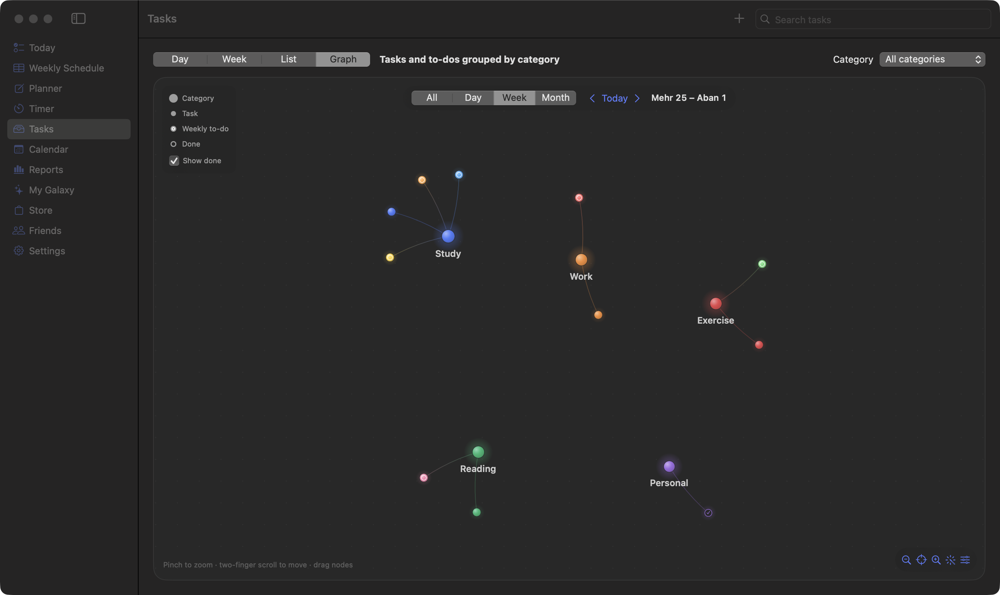
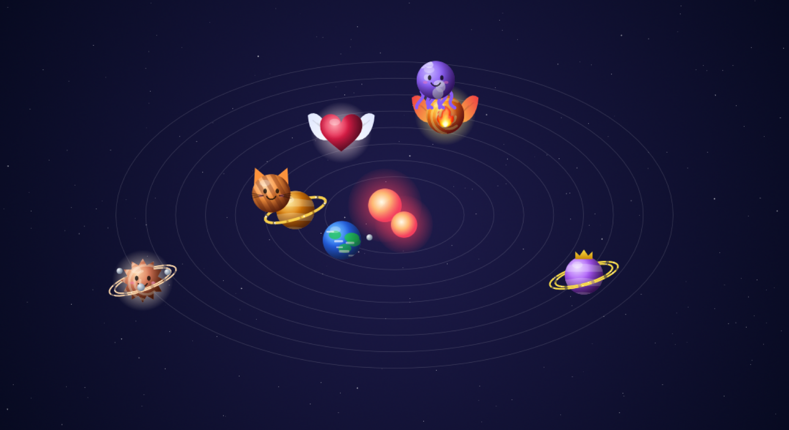
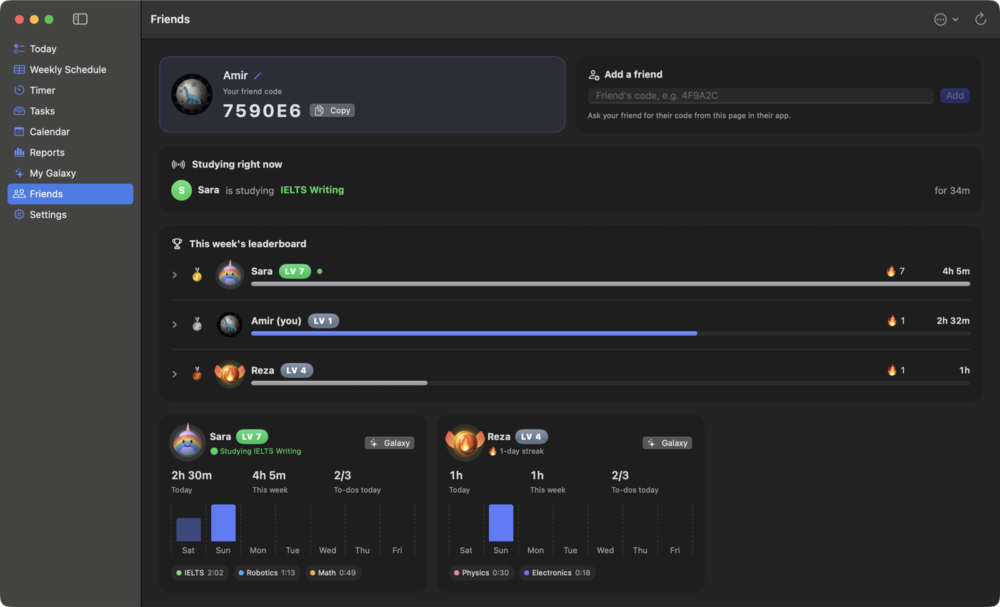

<div align="center">


# Orbit

**Plan your week, study with focus, and watch your galaxy grow.**

*Every journey starts with a single planet.* 🪐<br>
Plan your days, check off your tasks and start the timer.<br>
Every hour you study is fuel 🚀. Every 3 hours you level up and a new world appears in your sky.<br>
Collect rare planets, build solar systems, and race your friends to the top of the leaderboard.<br>
**Your study time builds your universe. How big will your galaxy get?** ✨

[](https://github.com/amirr-kdm/orbit/releases/latest/download/Orbit.zip)
[](https://github.com/amirr-kdm/orbit/releases/latest/download/Orbit-Setup.exe)
[](https://github.com/amirr-kdm/orbit/releases)
[](LICENSE)

  

</div>

> [!IMPORTANT]
> **New accounts need the admin's approval.** Because of server limits, every new account is approved by the admin before it can use Orbit.
> For faster approval, message me on Telegram: **[@amirr_kdm](https://t.me/amirr_kdm)**

---

## ⬇️ Download

| | Download | Requirements | First launch |
|---|---|---|---|
| 🍎 **macOS** | **[Orbit.zip](https://github.com/amirr-kdm/orbit/releases/latest/download/Orbit.zip)** | macOS 14+, Apple Silicon & Intel | Drag into Applications, then **right-click → Open** |
| 🪟 **Windows** | **[Orbit-Setup.exe](https://github.com/amirr-kdm/orbit/releases/latest/download/Orbit-Setup.exe)** | Windows 10 / 11, 64-bit | If SmartScreen appears: **More info → Run anyway** |

Mac and Windows share the same server, so friends on both platforms can study together.

---

## ✨ Features

| | |
|---|---|
| 🔐 **Account & cloud backup** | Sign up with email, username and password. Your data is saved on your computer and backed up to your account, so it works offline and comes back on any device. |
| 📅 **Weekly schedule** | Even/odd weeks, colours, categories, repeat rules and a live *Now / Next* card. |
| 📝 **Planner** | Draft future weeks with rich notes (checklists, tables, RTL text), then add them to your schedule. |
| ✅ **Today & Tasks** | Daily to-do list, Day / Week / List views with drag and drop, skipped to-dos, and an Obsidian-style **graph**. |
| ⏱ **Study timer** | Stopwatch or Pomodoro. Every session is saved. |
| 📊 **Reports & calendar** | Weekly and monthly charts, unfinished to-dos, Persian & Gregorian calendars. |
| 🌌 **My Galaxy** | **+1 level for every 3 hours** of study. Collect 50 planets and build solar systems. |
| 🛍 **Store** | Earn 🚀 rockets by studying and buy 40+ hand-made planets. |
| 👥 **Friends & groups** | Friend codes, live *studying now*, weekly leaderboards, groups with a weekly prize. |

---

## 🚀 Getting started

1. **Sign up** with an email, a username and a password, then wait for approval ([@amirr_kdm](https://t.me/amirr_kdm)).
2. **Build your week** in *Weekly Schedule*. Set a cell's type to **To-do** for things to study.
3. **Study** from *Today*: press **Study → Start**, then **Finish & Save**.
4. **Grow** your galaxy, earn rockets, and add friends with your code in *Friends*.

---

## 🎮 How progress works

| | |
|---|---|
| ⭐ **Levels** | Start at level 1, **+1 level per 3 hours** studied (max 50). Each level unlocks a planet. |
| 🚀 **Rockets** | 200 to start · **10 per study hour** · weekly bonus from 10 hours up (50 → 200) · **100** for topping a group's weekly board. |
| 🪐 **Store planets** | 100–1000 rockets by rarity (Common, Rare, Epic, Legendary). 3 refund tickets for everyone. |

<details>
<summary><b>📸 More screenshots</b></summary>
<br>

 
 
 
 

</details>

<details>
<summary><b>🪐 All 50 galaxy planets</b></summary>
<br>

</details>

<details>
<summary><b>🛍 All store planets</b></summary>
<br>

</details>

---

## 🔒 Privacy

- Your data lives **on your computer** and is backed up to **your account**. Only you can read your backup.
- Friends and groups see only **daily summaries**: study time, subjects, level, rockets and your galaxy. They never see your schedule, tasks or notes.
- Passwords are hashed and nobody can read them. If you forget yours, the admin can set a temporary one.

---

<details>
<summary><b>🛠 Build from source</b></summary>

**macOS** (Xcode 15+):
```bash
./build.sh install    # build and install Orbit.app
./build.sh release    # universal build → build/Orbit.zip
```

**Windows** (Node 20+, Rust), in [`windows/`](windows):
```bash
npm install
npm run tauri build
```

**Your own server:** create a [Supabase](https://supabase.com) project, run [`schema.sql`](supabase/schema.sql), [`groups.sql`](supabase/groups.sql) and [`accounts.sql`](supabase/accounts.sql), and turn off *Confirm email*. Put the URL and **publishable** key in `Resources/Supabase.plist` (Mac) or `VITE_SUPABASE_URL` / `VITE_SUPABASE_KEY` (Windows).

</details>

<div align="center">

**[MIT License](LICENSE)** · Made by [amirr-kdm](https://github.com/amirr-kdm) · Telegram [@amirr_kdm](https://t.me/amirr_kdm)

</div>
