<div align="center">


# Orbit

**Plan your week, study with focus, and watch your galaxy grow.**

*Every journey starts with a single planet.* 🪐<br>
Plan your days, check off your tasks and start the timer.<br>
Every hour you study is fuel 🚀. Every 3 hours you level up and a new world appears in your sky.<br>
Collect rare planets, build solar systems, fly your ship down the Level Pass,<br>
and team up with friends to take down space monsters before they escape. 👾<br>
**Your study time builds your universe. How big will your galaxy get?** ✨

[](https://github.com/amirr-kdm/orbit/releases/latest/download/Orbit.zip)
[](https://github.com/amirr-kdm/orbit/releases/latest/download/Orbit-Setup.exe)
[](https://github.com/amirr-kdm/orbit/releases)
[](LICENSE)

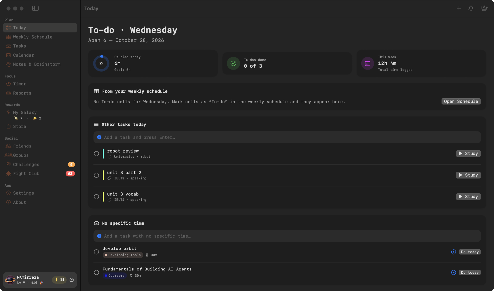 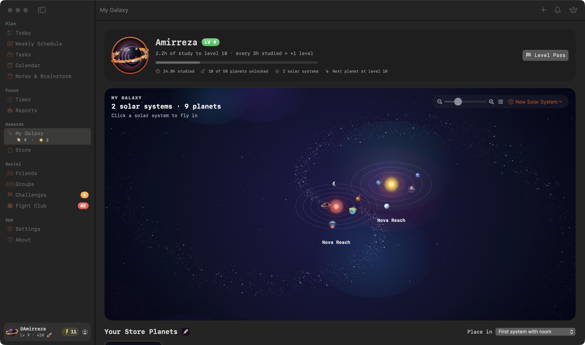 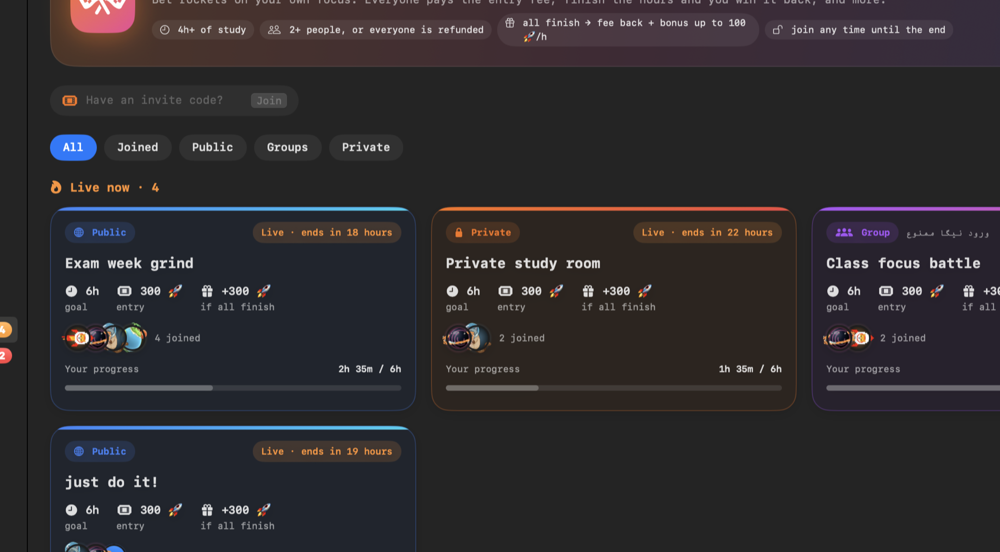

</div>

> [!IMPORTANT]
> **New accounts need the admin's approval.** Because of server limits, every new account is approved by the admin before it can use Orbit.
> For faster approval, message me on Telegram: **[@amirr_kdm](https://t.me/amirr_kdm)**

---

## ⬇️ Download

| | Download | Requirements | First launch |
|---|---|---|---|
| 🍎 **macOS** | **[Orbit.zip](https://github.com/amirr-kdm/orbit/releases/latest/download/Orbit.zip)** | macOS 14+, Apple Silicon & Intel | Drag into Applications, then **right-click → Open** |
| 🪟 **Windows** | **[Orbit-Setup.exe](https://github.com/amirr-kdm/orbit/releases/latest/download/Orbit-Setup.exe)** | Windows 10 / 11, 64-bit | If SmartScreen appears: **More info → Run anyway** |

Mac and Windows share the same server and the same account: sign in on both and your data follows you, and friends on either platform can study together.
Orbit tells you when a new version is out.

---

## ✨ Features

### 📚 Plan & study

| | |
|---|---|
| ☀️ **Today** | Your to-dos for the day, a live *Now / Next* card and one-tap **Study → Start**. A **No specific time** box keeps tasks that have no day yet; move them to today when you're ready. |
| 📅 **Weekly schedule** | Even/odd weeks, colours, categories, repeat rules, and cells that are fixed classes or to-dos. A slim strip under the table holds your "whenever" tasks. |
| ✅ **Tasks** | Day / Week / List views with drag and drop, skipped to-dos, and an Obsidian-style **graph** of your subjects. Press **⌘N / Ctrl+N** anywhere to add a task, with a category, for today or for whenever. |
| 📆 **Calendar** | Persian & Gregorian, with your study and to-dos on each day. |
| 🧠 **Notes & Brainstorm** | Rich notes (checklists, tables, RTL text) in folders with drag and drop. Draft a future week and add it to your schedule. |
| ⏱ **Study timer** | Stopwatch or Pomodoro. Every session is saved and counts everywhere. Any task, even one with no day, can be picked to study. |
| 📊 **Reports** | Weekly and monthly charts, time per subject, unfinished to-dos. Roll subcategories into their main category, and hover any colour of the daily chart to see the tasks behind it. |
| 🎨 **24 themes** | Calm, warm, paper, grey and pure black looks, plus fonts. Your choice syncs between devices. |

### 🌌 Rewards

| | |
|---|---|
| 🌌 **My Galaxy** | **+1 level for every 3 hours** of study (up to 60). Unlock planets, build solar systems of up to 8, and arrange them on an endless map. The sidebar counts your planets 🪐 and suns ☀️. |
| 🏁 **Level Pass** | Your ship flies forward after every study session. Claim rockets on every level (**25** up to level 9, **75** from level 10, **125** from level 20, +50 with every ten levels) and a special animated planet every 10 levels. |
| 🛍 **Store** | Spend 🚀 rockets on 50+ hand-made planets: Common, Rare, Epic and Legendary (some animated, plenty of food). |
| ⚡ **Streaks** | Days in a row with study, with **3 automatic streak freezes** every month. |

### 👥 Together

| | |
|---|---|
| 👥 **Friends** | Friend codes, live *studying now*, weekly leaderboards. |
| 🫂 **Groups** | Their own page: members' study, a weekly prize for the top studier, and **group challenges** that only members can join. |
| 🏆 **Challenges** | **Public** (everyone), **private** (invite code) or **group**. Join any time until it ends and study counts from the moment you join. Everyone pays an entry fee: if all finish, the fees are doubled; if some fail, those who finish share the fees. The detail page shows what each person studied and who is studying right now. |
| 🤝 **Promises** | Promise a friend you'll study X hours by a deadline, with rockets at stake. |
| 💥 **Fight Club** | A **World Boss** appears every week for the whole community, and you can summon monsters for your own goals. Every minute you study is a bullet; fly with ← → and fire with Space. Beat it before the deadline and the prize is split by damage. |
| 🔔 **Notification bell** | Top right, with an unread count: new challenges, gifts, prizes and new versions. Rest the mouse on one to mark it read. |

### 🔐 Account

| | |
|---|---|
| ☁️ **Cloud backup & sync** | Sign up with email, username and password. Your data lives on your computer, is backed up to your account and stays in sync between your Mac and PC. Works offline. |
| 🪶 **Light on battery** | Animations pause while Orbit is in the background, and only what's on screen moves. |

---

## 🚀 Getting started

1. **Sign up** with an email, a username and a password, then wait for approval ([@amirr_kdm](https://t.me/amirr_kdm)).
2. **Build your week** in *Weekly Schedule*. Set a cell's type to **To-do** for things to study.
3. **Study** from *Today*: press **Study → Start**, then **Finish & Save**.
4. **Grow**: claim rockets on the Level Pass, buy planets, and add friends with your code in *Friends*.
5. **Compete**: join a **Challenge**, make a **Group** with your class, and hit the weekly **World Boss** in *Fight Club*.
6. **Capture ideas fast**: press **⌘N / Ctrl+N** to add a task with no specific time and plan it later.

---

## 🎮 How progress works

| | |
|---|---|
| ⭐ **Levels** | Start at level 1, **+1 level per 3 hours** studied, up to **60**. |
| 🚀 **Rockets** | New Orbiters start with **800** · Level Pass rewards (25 → 75 → 125 …) · weekly bonus from 10 hours up (100 → 400) · **100** for topping a group's weekly board · challenge, promise and Fight Club prizes. |
| 👾 **Fight Club prize** | The weekly World Boss pays **1000 rockets**, split by damage. Your own monsters pay **45 rockets per hour** of the goal, +15% per size above the first. |
| 🪐 **Store planets** | 100–1000 rockets by rarity. 3 refund tickets for everyone. |

<details>
<summary><b>📸 More screenshots</b></summary>
<br>

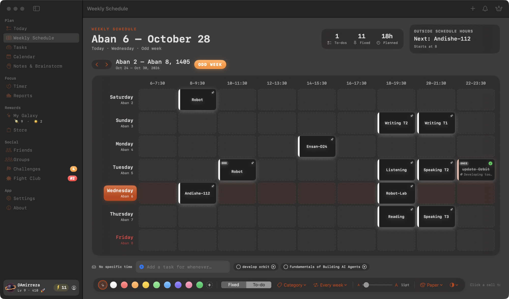 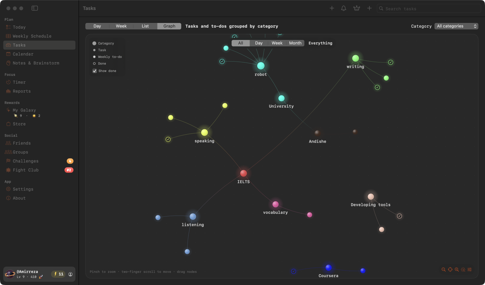
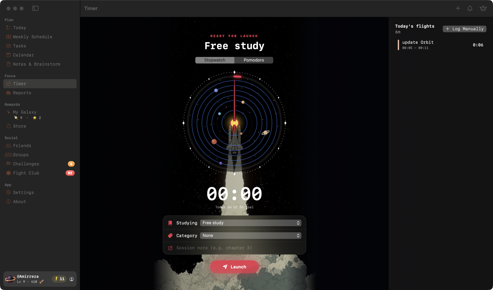 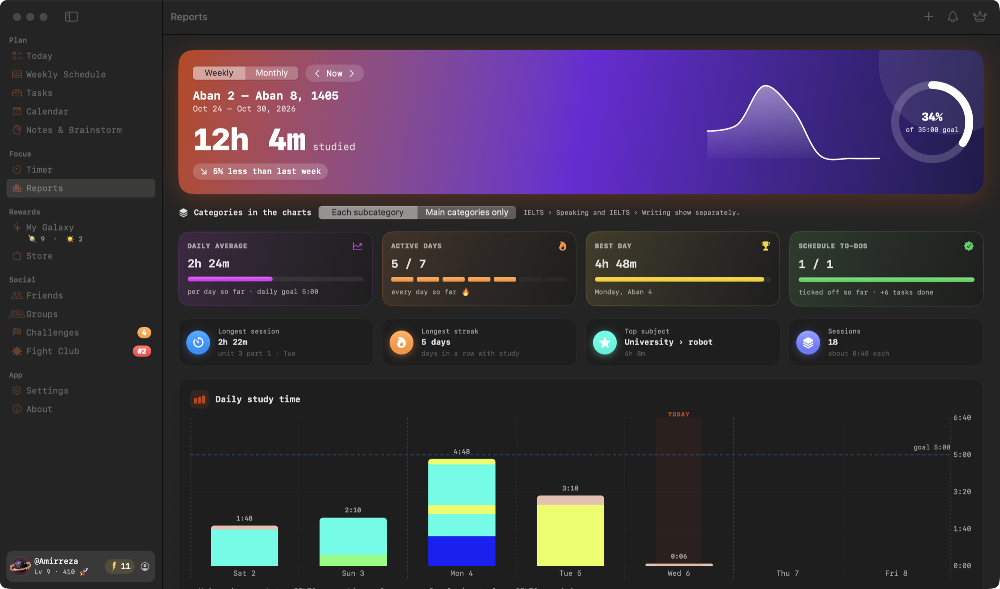
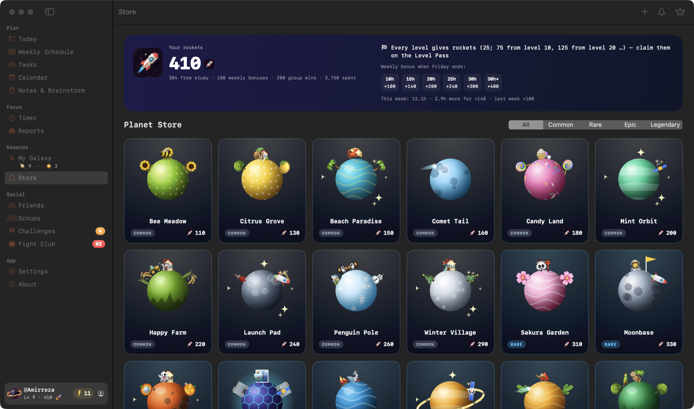 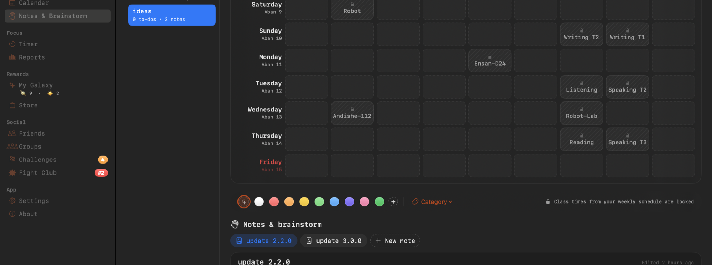
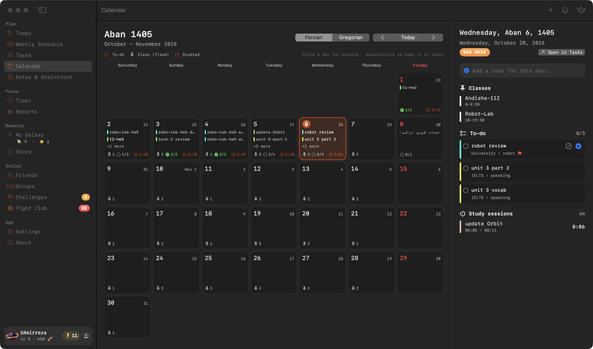 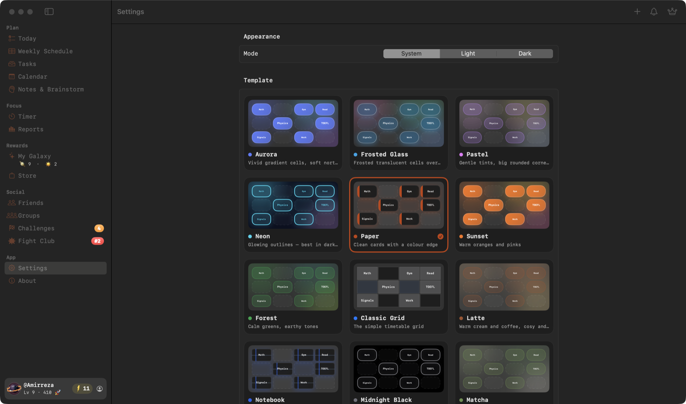

</details>

<details>
<summary><b>🪐 All 50 galaxy planets</b></summary>
<br>
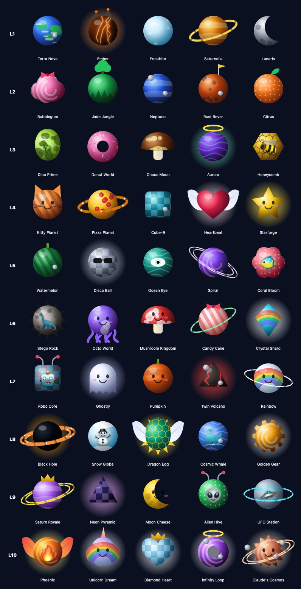
</details>

<details>
<summary><b>🛍 All store planets</b></summary>
<br>
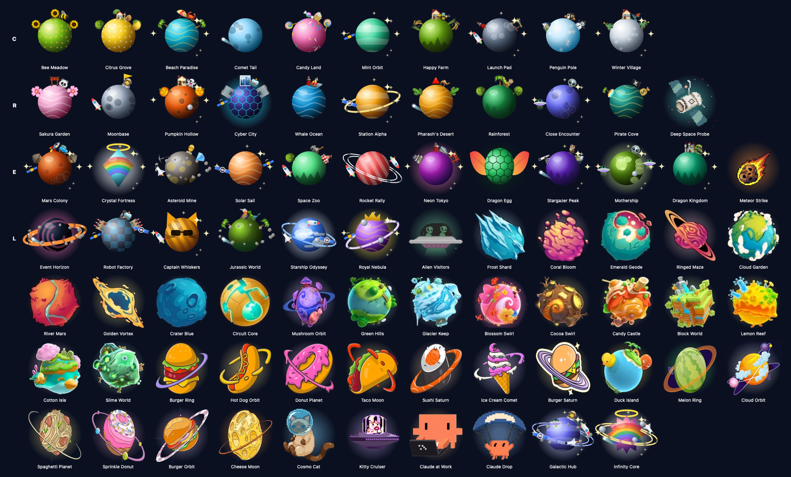
</details>

---

## 🔒 Privacy

- Your data lives **on your computer** and is backed up to **your account**. Only you can read your backup.
- Friends and groups see only **daily summaries**: study time, subjects, level, rockets, streak and your galaxy. They never see your schedule, tasks or notes.
- Rockets, challenges and Fight Club prizes are settled **on the server**, so they can't be changed from the app.
- Passwords are hashed and nobody can read them. If you forget yours, the admin can set a temporary one.

---

<details>
<summary><b>🛠 Build from source</b></summary>

**macOS** (Xcode 15+):
```bash
./build.sh install    # build and install Orbit.app
./build.sh release    # universal build → build/Orbit.zip
```

**Windows** (Node 20+, Rust), in [`windows/`](windows):
```bash
npm install
npm run tauri build
```

**Your own server:** create a [Supabase](https://supabase.com) project, run, in this order, [`schema.sql`](supabase/schema.sql), [`groups.sql`](supabase/groups.sql), [`accounts.sql`](supabase/accounts.sql), [`gifts.sql`](supabase/gifts.sql), [`challenges.sql`](supabase/challenges.sql) and [`bosses.sql`](supabase/bosses.sql), [`wallet.sql`](supabase/wallet.sql), [`world_boss.sql`](supabase/world_boss.sql), [`challenges_v2.sql`](supabase/challenges_v2.sql) and [`level_rewards.sql`](supabase/level_rewards.sql), and turn off *Confirm email*. Put the URL and **publishable** key in `Resources/Supabase.plist` (Mac) or `VITE_SUPABASE_URL` / `VITE_SUPABASE_KEY` (Windows).

</details>

<div align="center">

**[MIT License](LICENSE)** · Made by [amirr-kdm](https://github.com/amirr-kdm) · Telegram [@amirr_kdm](https://t.me/amirr_kdm)

</div>
