<div align="center">


# Orbit

**Plan your week, study with focus, learn words, and watch your galaxy grow.**

*Every journey starts with a single planet.* 🪐<br>
Plan your days, check off your tasks and start the timer.<br>
Every hour you study is fuel 🚀. Every 3 hours you level up and a new world appears in your sky.<br>
Keep your vocabulary in Leitner boxes, count down to your exams, and let your planet live in the notch of your screen.<br>
Collect rare planets, build solar systems, fly your ship down the Level Pass,<br>
and team up with friends to take down space monsters before they escape. 👾<br>
**Your study time builds your universe. How big will your galaxy get?** ✨

[](https://github.com/amirr-kdm/orbit/releases/latest/download/Orbit.zip)
[](https://github.com/amirr-kdm/orbit/releases/latest/download/Orbit-Setup.exe)
[](https://github.com/amirr-kdm/orbit/releases)
[](LICENSE)

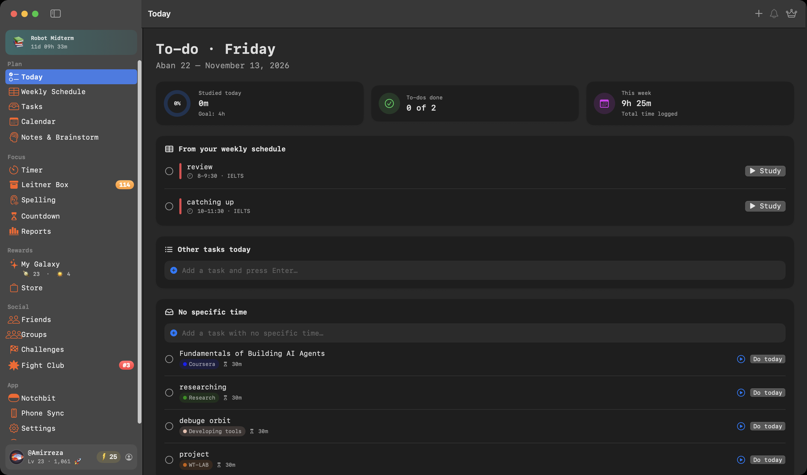 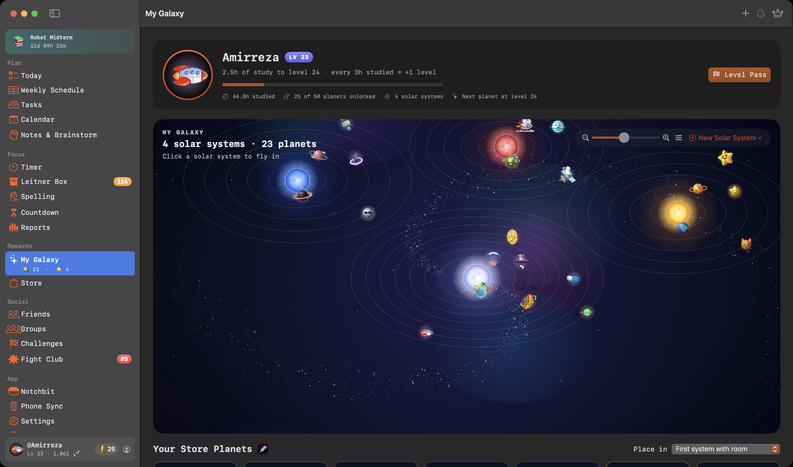 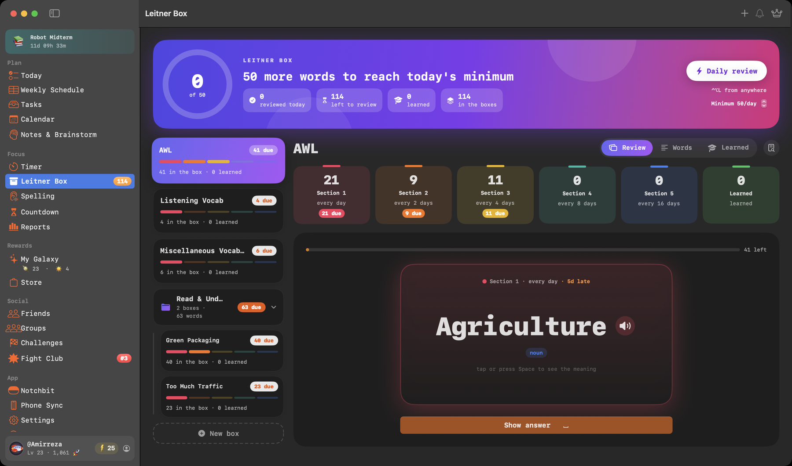

</div>

> [!IMPORTANT]
> **New accounts need the admin's approval.** Because of server limits, every new account is approved by the admin before it can use Orbit.
> For faster approval, message me on Telegram: **[@amirr_kdm](https://t.me/amirr_kdm)**

---

## Contents

- [What is Orbit?](#what-is-orbit)
- [Download](#️-download)
- [The big picture: how the app is organised](#the-big-picture)
- **Plan:** [Today](#️-today) · [Weekly Schedule](#-weekly-schedule) · [Tasks](#-tasks) · [Calendar](#-calendar) · [Notes & Brainstorm](#-notes--brainstorm)
- **Focus:** [Timer](#-timer) · [Leitner Box](#-leitner-box) · [Spelling](#-spelling) · [Countdown](#-countdown) · [Reports](#-reports)
- **Rewards:** [My Galaxy](#-my-galaxy) · [Level Pass](#-level-pass) · [Store](#-store) · [Streaks](#-streaks)
- **Social:** [Friends](#-friends) · [Groups](#-groups) · [Challenges](#-challenges) · [Promises](#-promises) · [Fight Club](#-fight-club) · [Notifications](#-notification-bell)
- **App:** [Notchbit](#-notchbit-orbit-in-your-notch) · [Phone Sync](#-phone-sync) · [Settings](#️-settings) · [Account and sync](#-account-and-sync) · [Shortcuts and little helpers](#-shortcuts-and-little-helpers)
- [Windows version](#-windows-version) · [How progress works](#-how-progress-works) · [Privacy](#-privacy) · [Build from source](#-build-from-source)

---

## What is Orbit?

Orbit is a **study planner that rewards you for studying**. It is one app that does four jobs:

1. **A planner.** A weekly schedule with even / odd weeks, a task board, a calendar and notes, so you always know what to study next.
2. **A focus tool.** A stopwatch / Pomodoro timer that records every session, with reports that show where your time goes.
3. **A memory tool.** Leitner boxes (the 1 · 2 · 4 · 8 · 16 day rule) with daily review and spelling practice, plus countdowns to your exams.
4. **A game around it.** Every hour you study becomes progress: levels, rockets, planets, solar systems, streaks, challenges with friends and a weekly monster to defeat together.

Your data lives **on your computer** (it works offline) and is backed up to **your account**, so your Mac and your Windows PC stay in sync. On a Mac with a notch, a small **planet sits beside the notch** and opens into a mini control panel with your timer, tasks, music and countdown.

---

## ⬇️ Download

| | Download | Requirements | First launch |
|---|---|---|---|
| 🍎 **macOS** | **[Orbit.zip](https://github.com/amirr-kdm/orbit/releases/latest/download/Orbit.zip)** | macOS 14+, Apple Silicon & Intel | Drag into Applications, then **right-click → Open** |
| 🪟 **Windows** | **[Orbit-Setup.exe](https://github.com/amirr-kdm/orbit/releases/latest/download/Orbit-Setup.exe)** | Windows 10 / 11, 64-bit | If SmartScreen appears: **More info → Run anyway** |

Mac and Windows share the same server and the same account: sign in on both and your data follows you, and friends on either platform can study together.
Orbit tells you when a new version is out (a banner on top of the window and a message in the bell).

---

## The big picture

The sidebar groups everything in the order you use it: **plan the week → do the work → collect rewards → study with people → settings.**

| Sidebar group | Pages | What it is for |
|---|---|---|
| **Plan** | Today · Weekly Schedule · Tasks · Calendar · Notes & Brainstorm | Decide what to study and when. |
| **Focus** | Timer · Leitner Box · Spelling · Countdown · Reports | Study, remember, and look back at the numbers. |
| **Rewards** | My Galaxy · Store | Spend and show what your study time earned. |
| **Social** | Friends · Groups · Challenges · Fight Club | Study together and compete. |
| **App** | Notchbit · Phone Sync · Settings · About | Make Orbit yours. |

At the top of the sidebar a **Countdown chip** shows your next big day (for example *"Midterm · 11d 09h 33m"*). At the bottom you see your name, level, rockets and streak. In the top bar there is a **＋** (quick add a task), the **🔔 bell** and the **👑 Level Pass** shortcut.

---

# Plan

## ☀️ Today


Your day on one page.

- **Three summary cards**: how much you studied today against your daily goal (with a progress ring), how many to-dos are done (*"0 of 2"*), and your total study time this week.
- **From your weekly schedule**: every to-do cell of the weekly schedule that falls on today, in time order, with its time slot and category. A live **Now / Next** highlight shows the slot you are in. Press **Study** on a row and the timer opens with that to-do already selected.
- **Other tasks today**: the tasks you added for today. Type a title and press Enter to add one.
- **No specific time**: a pool of tasks with no day and no time ("whenever"). Add one with the field, and when you are ready press **Do today** to move it to today. The ▶ button starts the timer on it.
- Tap the circle to mark a to-do done; a second tap marks it *skipped* (won't do) so it stops nagging you.
- Study sessions you finished today are listed with their length, and the page tells you when none exist yet.

## 📅 Weekly Schedule

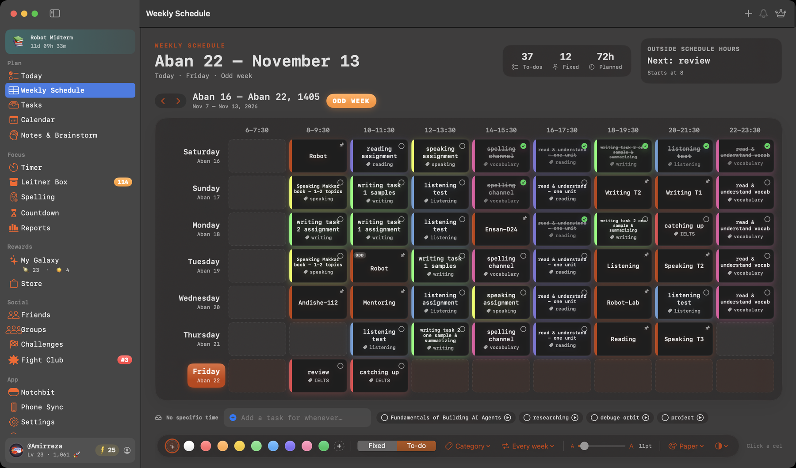

The table that your whole week is built on: **days down the side, time slots across the top.**

- **Cells.** Click a cell and type. Each cell has a **type**: *Fixed* (a class or a meeting) or *To-do* (something you study; it shows up in Today, Tasks and the timer). A done to-do shows a ✅, a fixed cell a 📌.
- **Even / odd weeks.** A cell can repeat *Every week*, only in *Even weeks*, only in *Odd weeks*, or *This week only*. The header tells you whether this is an **EVEN WEEK** or **ODD WEEK**. In weeks where a cell is empty but used in other weeks, a faint reminder of the other week's item shows.
- **Colours and categories.** Pick a colour from the palette under the table (you can add your own and delete any), or give the cell a **category** so it takes the category's colour (Settings → Categories → *To-dos use their category's colour*).
- **Hover card.** Rest the pointer on a cell (or click it) and a card opens with the cell's text, category, type and repeat rule, an editable **Study time** (the minutes the Pomodoro will use), **Notes**, **Copy**, **Edit cell** and a big **Study now** button.
- **Copy and paste.** Copy a to-do and paste it into another cell, or onto a day of the Tasks board. Right-click a cell for *Edit, Copy, Paste*, change its type, repeat rule or category, mark it done, or clear it.
- **Time slots** are yours to define (Settings → Schedule): add, remove and change the start and end of each slot.
- **24 templates and many fonts.** Calm, warm, paper, grey and pure black looks (Aurora, Frosted Glass, Pastel, Neon, Paper, Sunset, Forest, Classic Grid, Latte, Midnight, Sakura, Nordic and more) change the table, the page background and the accent colour. Your choice syncs between devices.
- **Now marker.** The current time slot of today is outlined so you always see where you are.
- A slim strip under the table (**No specific time**) holds your "whenever" tasks.

## ✅ Tasks

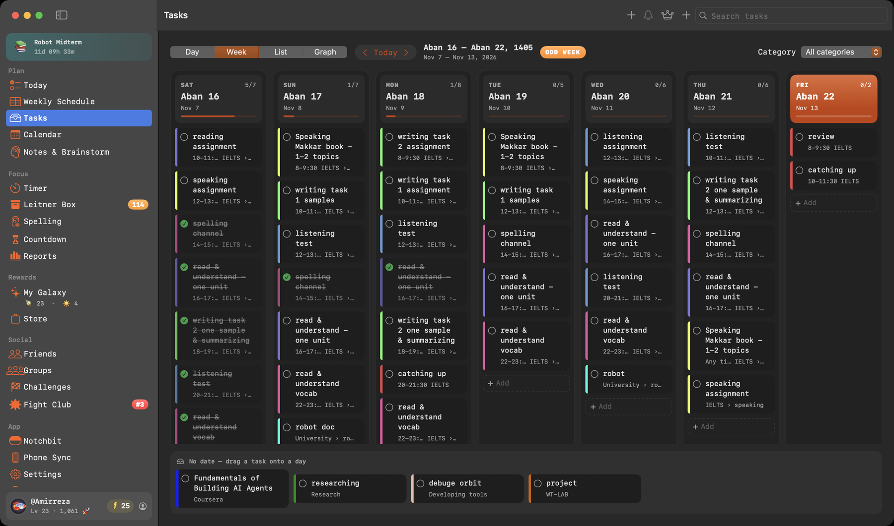

Everything you have to do, in four views (the switch at the top): **Day · Week · List · Graph.**

- **Week board.** One column per day, with a progress bar and *done / total* for each. Weekly-schedule to-dos and one-off tasks sit side by side. **Drag and drop** a card to another day to move just that day's session. The columns for "No date" tasks sit under the board.
- **Status.** Tap the circle: done ✓; tap again: skipped (won't do). Skipped to-dos can be brought back.
- **Right-click a one-off task**: *Edit, Mark as Done, Skip, Move to, Study Now, Copy, Delete.*
- **Right-click a weekly-schedule to-do**: *Edit…, Mark as Done, Skip, Move to, Study Now, Copy, Show in Weekly Schedule.* **Edit…** opens a panel where you can change the title, category, **day and time in the week**, how often it repeats, its study time and notes. Choose **No specific time** to make it a to-do that repeats on a day without a time. If the target cell already holds another to-do that repeats the same way, Orbit warns you that saving replaces it.
- **Paste Here.** Right-click a day column to paste a copied to-do as a task on that day.
- **Search and filter.** A search box (*Search tasks*) and a **category filter** narrow the board.
- **Graph.** An Obsidian-style graph of your subjects, categories and to-dos. Click a node to read and edit its details and notes.
- **Quick add anywhere.** Press **⌘N** (Ctrl+N on Windows): type a task, choose a category, and decide *today*, *a day* or *whenever*. You can start studying it right away.

## 📆 Calendar

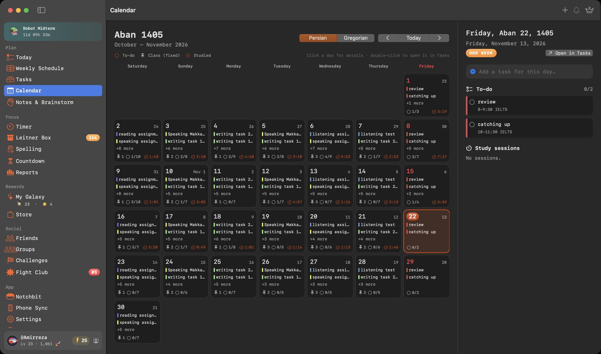

A month view with the **Persian (Jalali) and Gregorian calendars side by side** (switch the primary one with the toggle, the other is always shown on each day).

- Each day shows its fixed classes, to-do progress (*done / total*) and how much you studied.
- **Click a day** to see its details on the right: the to-dos with their status and the study sessions. **Double-click a day** (or press **Open in Tasks**) to jump to that day in Tasks.
- Today is highlighted, and the week even / odd tag is shown.

## 🧠 Notes & Brainstorm

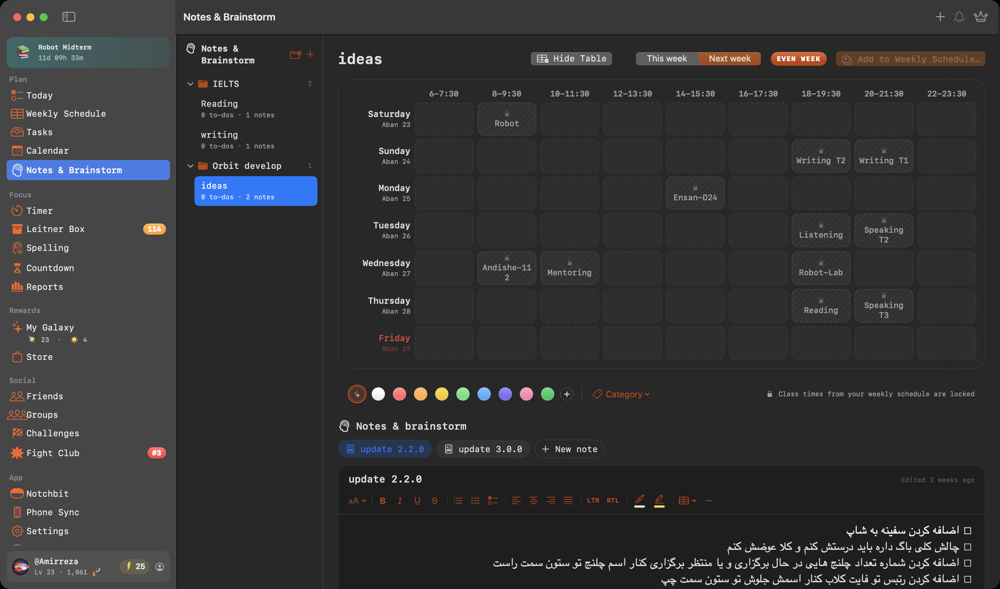

A place to **plan a future week and keep notes**, separate from your live schedule.

- **Planners.** Each planner has its own **weekly plan table** (same days and time slots as your schedule) and its own notes. Class times from your weekly schedule are shown locked, so you never plan over a class.
- **Folders.** Group planners into folders with drag and drop.
- **Add to Weekly Schedule…** When a plan is ready, add it to *this week* or *next week*, choose a **repeat rule** (every week, even, odd, once) and a category. Orbit lists the **clashes** with your existing to-dos and asks what to do with each, skips cells that sit on class times, and tells you what it added.
- **Rich notes.** Notes with a toolbar: checklists, tables, colours, headings, and right-to-left text for Persian. Each note shows when it was last edited; create as many as you like.
- Hide the plan table to give the notes the whole page.

---

# Focus

## ⏱ Timer

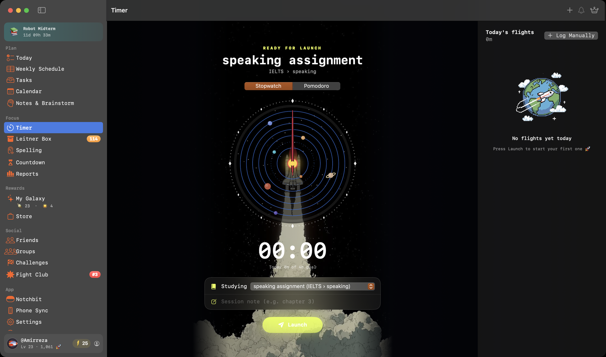

A launch pad for your study sessions, drawn as a solar system clock with a rocket.

- **Stopwatch or Pomodoro.** Stopwatch counts up (toward your daily goal). Pomodoro counts down a focus period, then a break, and keeps going. Set the **focus and break lengths** right on the page.
- **What are you studying?** Pick a to-do from today's schedule or tasks (even one with no day), or choose **Free study** and a **category**. A to-do that has its own **study time** makes the Pomodoro exactly that long.
- **Session note.** Add a note such as *"chapter 3"*; it is saved with the session.
- **Launch, Pause, Finish & Save, Discard.** Every finished session is recorded and counts everywhere: reports, the calendar, your level, challenges and Fight Club.
- **Today's flights.** The right-hand column lists every session of the day with its time range and length, and the day's total. **Log Manually** adds a session you forgot to start (it shows in reports and the calendar but earns no rewards).
- **Day and night.** The page follows your light / dark mode (a night launch sky or a daylight sky).
- **The timer survives closing the app.** The open session comes back paused, with its time.
- **Alarm.** When a Pomodoro phase ends you get a sound (choose it and its volume in Settings) and a notification, even if Orbit is in the background.
- **Are you still there?** If you leave the timer running while you are away, a small window asks. No answer in 3 minutes and the timer stops, keeping the time up to the question. It only asks when the keyboard and mouse have not been touched for the time you choose (Settings → Timer).
- **Pause in chosen apps.** Pick apps such as Telegram; while one of them is in front, the timer pauses, and it carries on when you leave it.
- A **menu-bar timer** and the **Notchbit** panel show and control the timer from anywhere.

## 🗂 Leitner Box


A spaced-repetition word trainer built on the **Leitner system**: words you know come back later and later, words you forget come back tomorrow.

- **Boxes.** Make as many boxes as you like (for example *IELTS vocabulary*). Each box keeps its words in its **own CSV file** on your computer, so you can open or back it up anywhere.
- **Five sections.** A new word starts in section 1. Every right answer moves it up: it comes back after **1, 2, 4, 8 and 16 days**. A wrong answer sends it back to section 1. A word you still know in section 5 becomes **learned**.
- **Hero.** A ring shows how many words you reviewed today against your **daily minimum** (change it with the stepper), plus counters for *reviewed today, left to review, learned* and *in the boxes*.
- **Daily review window.** The **⚡ Daily review** button (or **⌃⌥L** from any app) opens a small window with the words that are due. Show the meaning, press *knew it* or *didn't know*.
- **Three tabs per box.** **Review** (counts per section, with the due ones highlighted, then the flash card with a speaker button that reads the word aloud), **Words** (add words, one per line as `word - meaning`; browse each section) and **Learned** (the finished words, with a way to bring one back).
- **Topics.** Group small boxes under one subject, for example **Read & Understand › Green Packaging**. Make a topic from a box, add boxes inside it, rename it, or move a box into another topic. Topics fold open and closed in the list.
- **Menu-bar count.** A small 📖 number at the top of your screen shows today's reviewed words (optional), and an orange badge on the sidebar item and next to the notch planet shows how many are left.
- The reading voice is yours to choose (Settings → Words).

## 👂 Spelling

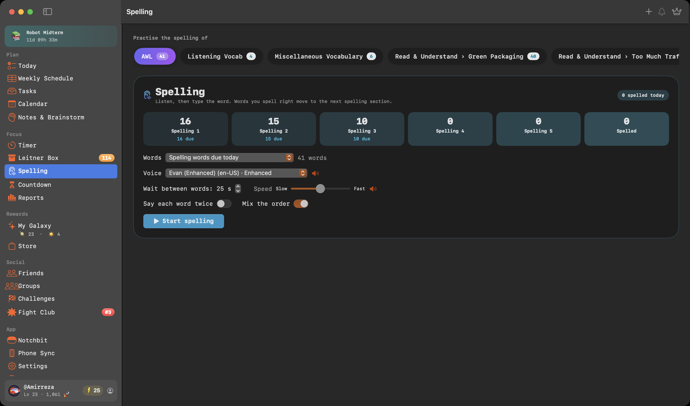

Practise the **spelling** of the words in a box **by ear**.

- Pick a box at the top. Orbit **says the word**; you have a few seconds to **type it**.
- Spelling has its **own six sections** (Spelling 1 to 5 and *Spelled*), separate from the meaning review, and a right spelling moves the word on the same 1 · 2 · 4 · 8 · 16 day ladder.
- Choose which words to practise (**due today** or **all words**), the **wait between words** (1 to 30 seconds), the voice **speed**, **say each word twice**, and **mix the order**.
- A timer bar shows the time left to write. **Hear again** repeats the word, **Next word ⏎** moves on.
- After a round you see how many you spelled right, what you wrote for the ones you missed, and a button to **practise only the missed words**. A counter shows how many words you spelled today.
- Adding a word with a typo is blocked (Orbit suggests the right spelling), so your boxes stay clean.

## ⏳ Countdown

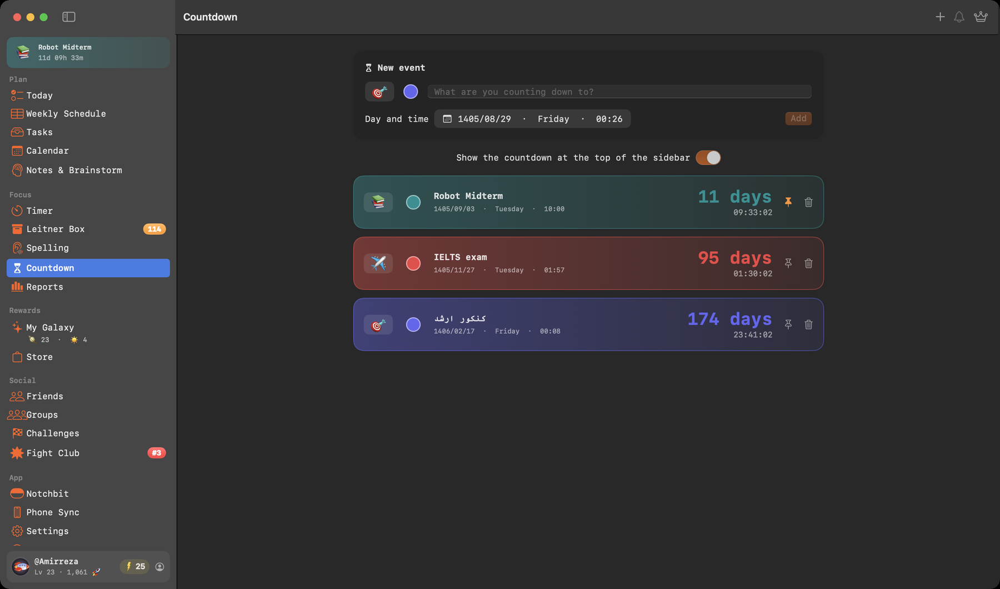

Count down to the days that matter: exams, trips, deadlines.

- **Add an event**: an emoji (30 to choose from), a colour (10 presets or any custom colour), a title, and a **day and time** from a **Persian date picker** (Persian months, weeks from Saturday, right-to-left).
- Every card shows the **Persian date, weekday and time** and a **live countdown** ("11 days", then `HH:MM:SS`). Past events fade and say *"X days ago"*.
- **Pin** one event: it is the one the sidebar chip and the notch show (otherwise the next upcoming one is used).
- Turn the **sidebar chip** on or off with the switch on the page.

## 📊 Reports

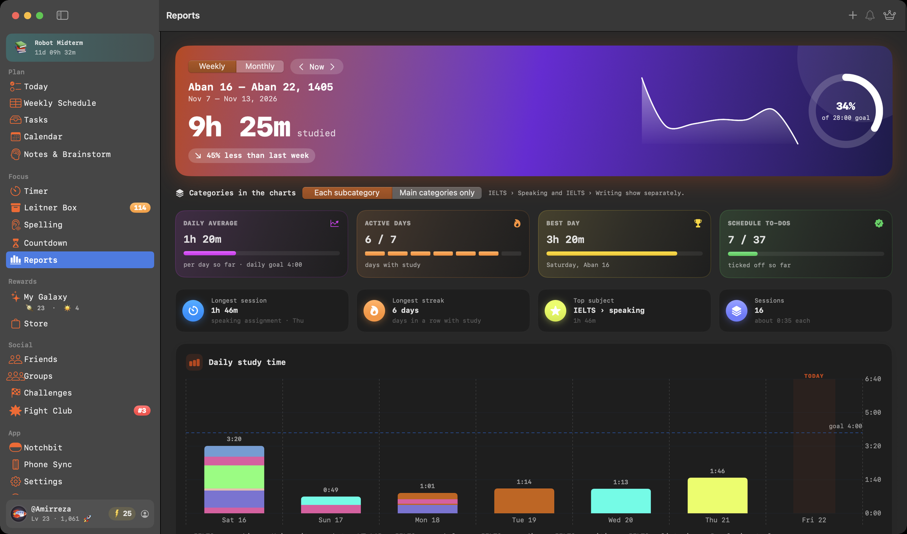

Look back at where your time went.

- **Period.** Weekly or monthly, and move between periods. A ring shows the share of your goal.
- **Daily study chart**: stacked bars by subject with a goal line. Hover a colour to see the tasks behind it. A **line chart** shows the trend.
- **Subjects.** Time per subject and category with percentages. Choose whether the charts show **each subcategory** or roll them up into **main categories only**.
- **Cards.** Daily average, active days, best day, to-dos done, longest session, longest streak, your top subject, number of sessions, and *"You focus most around …"* (your best hour).
- **Unfinished to-dos** for the period are listed too.

---

# Rewards

## 🌌 My Galaxy


Your study time, turned into a universe.

- **+1 level for every 3 hours** you study (up to level 60). Every level gives you a new planet to place. The profile card shows your level, hours to the next level, planets and suns.
- **50 hand-made planets** across ten groups, unlocked every 5 levels (Starter Worlds, Explorer, Wild Worlds, Shapes & Snacks, Deep Space and more).
- **Solar systems.** Add suns (yellow, red, blue, white, binary, pulsar) and put planets in orbit. A system can hold as many planets as you like; give each its **own name**, size and orbit gap.
- **An endless map.** Drag systems anywhere, zoom in and out (pinch or scroll), and click a system to fly into it. The sidebar shows how many planets 🪐 and suns ☀️ you own.
- **Profile picture.** Choose any planet as your avatar. Friends see your galaxy too.
- **Your store planets** (the ones you bought) sit under the map and can be placed like any other.

<details>
<summary><b>🪐 All 50 galaxy planets</b></summary>
<br>
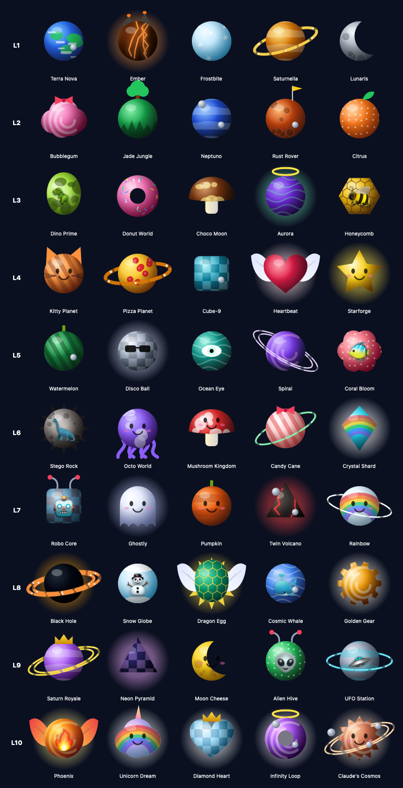
</details>

## 🏁 Level Pass

Your ship flies forward after every study session, and every level has a reward waiting.

- Claim **rockets on every level**: **25** up to level 9, **75** from level 10, **125** from level 20, and +50 with every ten levels.
- **A special animated planet every 10 levels.**
- Claiming works **offline-safe**: a claim made without internet is kept and sent when you are back online.
- Open it with the **👑** button in the top bar or from My Galaxy.

## 🛍 Store

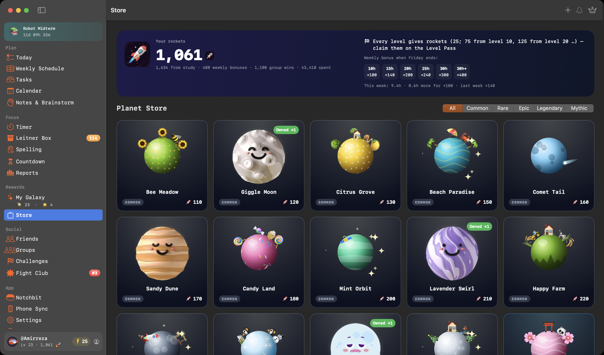

Spend your 🚀 rockets on **50+ hand-made store planets**.

- Rarities: **Common, Rare, Epic, Legendary and Mythic**, with prices from 100 to 1000 rockets. Many are animated or have little creatures and spacecraft.
- Filter by rarity, see the price and how many you own, and buy as many copies as you like.
- **3 refund tickets** for everyone, in case you change your mind.
- Bought planets can be placed in your galaxy or used as your avatar (and as the planet in the notch).

<details>
<summary><b>🛍 All store planets</b></summary>
<br>
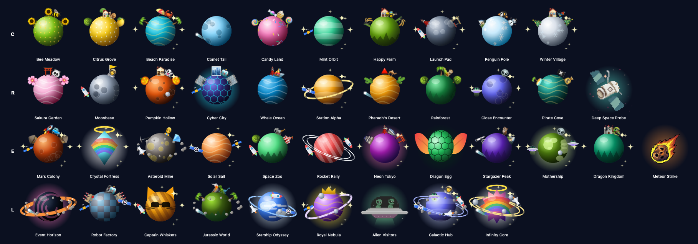
</details>

## ⚡ Streaks

Days in a row with study. Orbit gives you **3 automatic streak freezes every month**, so one lazy day does not break a long streak. The streak shows next to your name in the sidebar.

---

# Social

> The Friends, Groups, Challenges and Fight Club pages are shown inside Orbit with live data, so they are described here without pictures of other people's accounts.

## 👥 Friends

Add friends with your **friend code**. See who is **studying right now** (live, with what they study and for how long), compare weekly **leaderboards** (all Orbiters or just friends), and look at each other's galaxy. A badge on the sidebar counts friends studying now.

## 🫂 Groups

Make a group for your class or study team (a name, an invite code). Members' study is shown side by side, the **top studier of the week wins 100 rockets**, and groups can run their own **group challenges** that only members can join.

## 🏆 Challenges

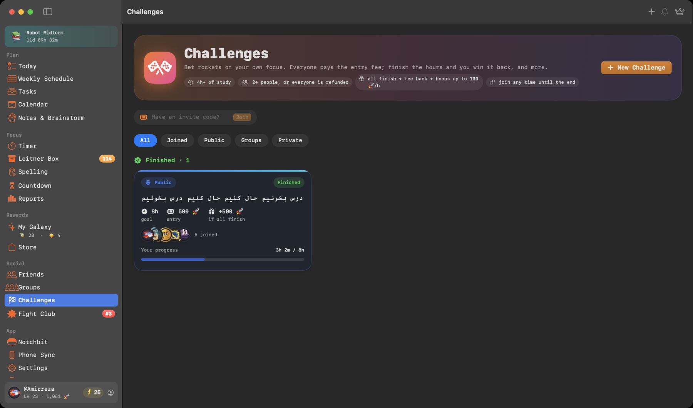

Set a study goal and compete.

- **Public** (everyone), **private** (with an invite code) or **group** challenges.
- Join any time until it ends; study counts **from the moment you join**.
- Everybody pays an **entry fee** in rockets. If everyone finishes, the fees are **doubled**; if some fail, the ones who finish share the fees.
- The detail page shows what each person studied, how far they are and who is studying right now. A badge on the sidebar counts challenges that are running.

## 🤝 Promises

Promise a friend you will study **X hours by a deadline**, with rockets at stake. Keep it and you win; miss it and your friend does.

## 💥 Fight Club

A **World Boss** appears every week for the whole community, and you can summon monsters for your own goals.

- Every minute you study is a bullet. Fly with **← →** and fire with **Space** (it shows the next damage, the boss's health and a countdown to Friday).
- Beat the boss before the deadline and the **1000-rocket prize is split by damage**. Your own monsters pay **45 rockets per hour of the goal** (+15% per size above the first).
- Boss tasks are made for a boss: only study in that subject shoots at it. The sidebar shows your place on the board (**#2**).

## 🔔 Notification bell

Top right, with an unread count: new challenges, gifts, prizes and new versions of Orbit. Rest the pointer on a message to mark it read; tap it to jump to the page.

---

# App

## 🪐 Notchbit: Orbit in your notch

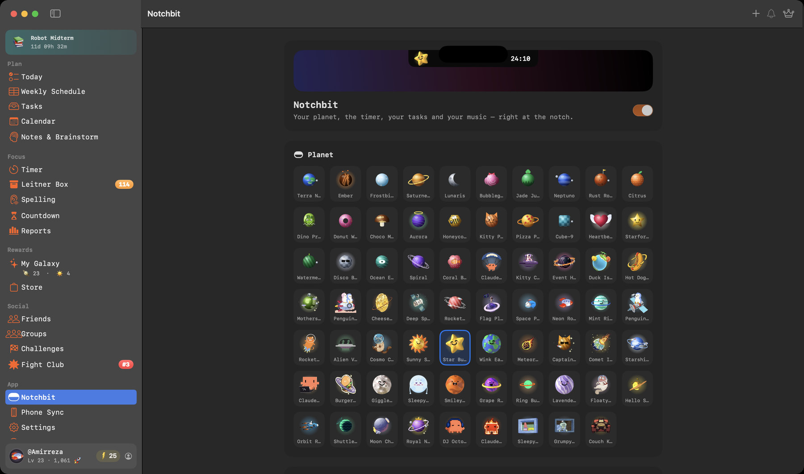

On a Mac with a notch (and a pretend one on Macs without), a **small planet sits beside the notch** and grows into a control panel. Everything wakes up from system events: nothing runs in a loop, so it is light on the battery.

**The three states**
- **Closed**: your planet on the left, the timer (or a headphones picture while music plays) on the right of the notch, an orange number for words to review.
- **Peek**: rest the pointer on it (or swipe down with two fingers). It shows what matters right now: *Next up*, the music, the running timer, or *"Ready to focus?"* with a Start button.
- **Full**: click the peek (or the planet). Four tabs: **Timer, Tasks, Music, Days**. A gear opens the Notchbit settings and a chevron folds it back.

**What each tab does**
- **Timer**: a ring with the time, pick a task, Start / Pause / Resume / Finish / Discard and Stopwatch or Pomodoro.
- **Tasks**: today's to-dos with ▶ (start the timer) and ✓ (mark done), and a field to add a task.
- **Music**: cover, title, artist and play / pause / next / previous. Works with **Apple Music and Spotify**, and with other apps through macOS Now Playing (experimental). Covers that Apple Music does not hand over can be found online. After you pause, the music view stays for a while in case you play again.
- **Days**: the pinned countdown with its live clock.

**More things it does**
- **Volume and brightness** appear in the notch (under it or beside it) with a bar whose colour changes with the level; pick your own colours. Turn on **Replace the macOS panel** and only the notch shows (Orbit asks for Accessibility permission once for the volume and brightness keys).
- **Keyboard language** (EN, FA…) when you switch layouts, **battery** (plugging the charger in or out, 20% and 80%), a **lock sign** when you lock the Mac, and a **next song** hint when a track changes.
- **Next up**: a few minutes before a weekly-schedule item starts (5, 10, 15 or 30 minutes), the notch opens with its name and a **Start** button.
- **Lock screen** (experimental): show the notch on the lock screen.
- **Always on**: *Keep the notch when I quit* (⌘Q only closes the windows and the Dock icon; the notch stays), *Open Orbit when I log in*, and **Quit Orbit completely**. Logging out and shutting down are never blocked.
- **Your planet.** Choose any planet you unlocked or bought, or one of the **notch-only pictures** (DJ Octopus, Claude on Fire, Sleepy Window, Grumpy Window, Couch Knight). Choose the **music picture** that dances while music plays, and its size.
- **Feel**: opening mode (pointer or swipe, or swipe only), haptic tap and its strength, animation speed, how long before it opens and closes, planet size.

## 📱 Phone Sync

Planned: keep your Mac and the iPhone app in step (tasks, categories, study sessions and Pomodoro settings through a private code). It is shown as **Coming soon** for now.

## ⚙️ Settings

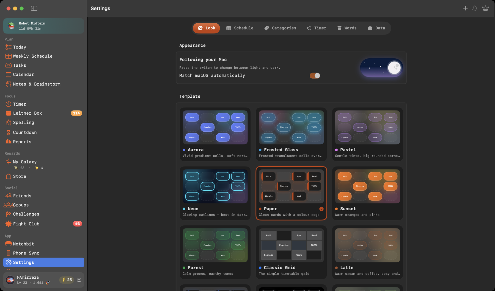

Settings are grouped in six tabs:

| Tab | What you can change |
|---|---|
| **Look** | **Day / night** switch (or follow macOS), the table **template** (24 of them), the **font** (some change the whole app, others only the weekly schedule), the schedule's text size. |
| **Schedule** | The **primary calendar** (Persian or Gregorian), and your **weekly time slots** (add, remove, change start and end). |
| **Categories** | Task **categories and subcategories** with colours, and *To-dos use their category's colour*. |
| **Timer** | Pomodoro focus and break lengths, the daily study goal, the **alarm sound** and volume, the **still-studying check**, and **apps that pause the timer**. |
| **Words** | The **reading voice** for the Leitner box, and the 📖 word count in the menu bar. |
| **Data** | Shows where your data file is saved on this computer, with a *Show in Finder* button. (The schedule's *Reset to Default* button on the Schedule tab clears the table and restores the default time slots.) |

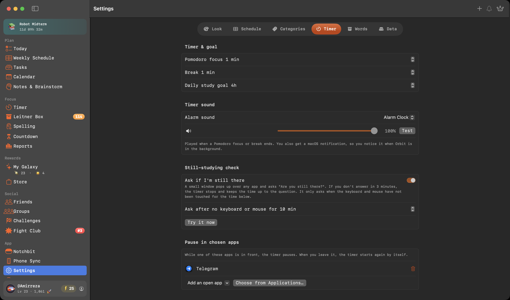 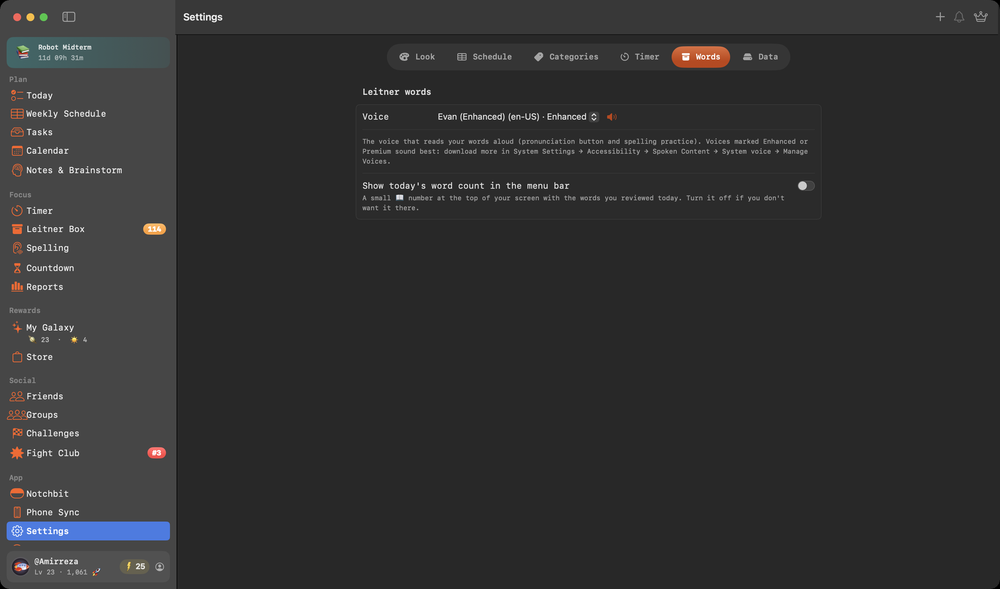

## ☁️ Account and sync

- **Sign up** with an email, a username and a password. The admin approves new accounts (see the note at the top).
- Your data lives **on your computer**, is **backed up to your account** and stays **in sync** between your Mac and your PC. Orbit **works offline** and opens right away even on a slow connection (it does not wait on the spinner).
- Your profile (the **account button** at the bottom of the sidebar) shows your name, level, rockets and streak, and lets you sign out. If you forget your password the admin can set a temporary one.
- **Light on battery**: animations pause while Orbit is in the background, and only what is on screen moves.
- **About** shows the version, who built Orbit, and links to the Orbit Telegram channel (news and updates) and the Orbiters' group (find friends and plan challenges).

## ⌨️ Shortcuts and little helpers

| | |
|---|---|
| **⌘N** (Ctrl+N) | Add a task from anywhere. |
| **⌃⌥L** | Open the daily Leitner review from any app (Mac). |
| **Menu-bar item** | Timer start / pause, today's study time, words reviewed and left. |
| **Right-click** | Almost every card and cell has a menu: edit, copy, paste, move, skip, study now. |
| **Drag and drop** | Move a to-do to another day, planners into folders, systems on the galaxy map. |
| **Copy and paste** | Copy a to-do from a cell or the Tasks page and paste it into a cell or a day. |

---

## 🪟 Windows version

The Windows app is the same Orbit (Tauri) and uses the same account. It has the planner, tasks, calendar, notes, timer, reports, galaxy, store, friends, groups, challenges and Fight Club, plus the newer pieces:

- **Leitner Box, Spelling, Countdown** (with the Persian date and time picker and the sidebar chip).
- **Notchbit island**: a small always-on-top bar at the top centre of the screen (planet, timer, tasks, music, countdown, *Next up*), with its own settings page. Closing the window keeps the island running; the system-tray icon opens or quits Orbit.
- **Timer guard** ("Are you still there?" and pause in chosen programs), the timer coming back after you close the app, and Pomodoro lengths on the timer page.
- **Weekly schedule** hover card and copy / paste, **edit weekly to-dos from Tasks**, and **No specific time** weekly to-dos.
- **Settings in tabs** with a day / night switch.

Not on Windows (yet): volume, brightness, battery, lock and keyboard-language in the island, and Phone Sync.

---

## 🎮 How progress works

| | |
|---|---|
| ⭐ **Levels** | Start at level 1, **+1 level per 3 hours** studied, up to **60**. |
| 🚀 **Rockets** | New Orbiters start with **800** · Level Pass rewards (25 → 75 → 125 …) · weekly bonus from 10 hours up (100 → 400) · **100** for topping a group's weekly board · challenge, promise and Fight Club prizes. |
| 👾 **Fight Club prize** | The weekly World Boss pays **1000 rockets**, split by damage. Your own monsters pay **45 rockets per hour** of the goal, +15% per size above the first. |
| 🪐 **Store planets** | 100–1000 rockets by rarity. 3 refund tickets for everyone. |
| 📚 **Words** | The Leitner box and Spelling are for you only: they do not give levels or rockets. |

---

## 🔒 Privacy

- Your data lives **on your computer** and is backed up to **your account**. Only you can read your backup.
- Leitner words stay **on your computer** (one CSV file per box).
- Friends and groups see only **daily summaries**: study time, subjects, level, rockets, streak and your galaxy. They never see your schedule, tasks, words or notes.
- Rockets, challenges and Fight Club prizes are settled **on the server**, so they can't be changed from the app.
- Passwords are hashed and nobody can read them. If you forget yours, the admin can set a temporary one.
- The notch's music covers are looked up online only if you leave *Find missing covers online* on, and only the song and artist are sent.

---

<details>
<summary><b>🛠 Build from source</b></summary>

**macOS** (Xcode 15+):
```bash
./build.sh install    # build and install Orbit.app
./build.sh release    # universal build → build/Orbit.zip
```

**Windows** (Node 20+, Rust), in [`windows/`](windows):
```bash
npm install
npm run tauri build
```

**Your own server:** create a [Supabase](https://supabase.com) project, run, in this order, [`schema.sql`](supabase/schema.sql), [`groups.sql`](supabase/groups.sql), [`accounts.sql`](supabase/accounts.sql), [`gifts.sql`](supabase/gifts.sql), [`challenges.sql`](supabase/challenges.sql) and [`bosses.sql`](supabase/bosses.sql), [`wallet.sql`](supabase/wallet.sql), [`world_boss.sql`](supabase/world_boss.sql), [`challenges_v2.sql`](supabase/challenges_v2.sql) and [`level_rewards.sql`](supabase/level_rewards.sql), and turn off *Confirm email*. Put the URL and **publishable** key in `Resources/Supabase.plist` (Mac) or `VITE_SUPABASE_URL` / `VITE_SUPABASE_KEY` (Windows).

</details>

<div align="center">

**[MIT License](LICENSE)** · Made by [amirr-kdm](https://github.com/amirr-kdm) · Telegram [@amirr_kdm](https://t.me/amirr_kdm)

</div>
